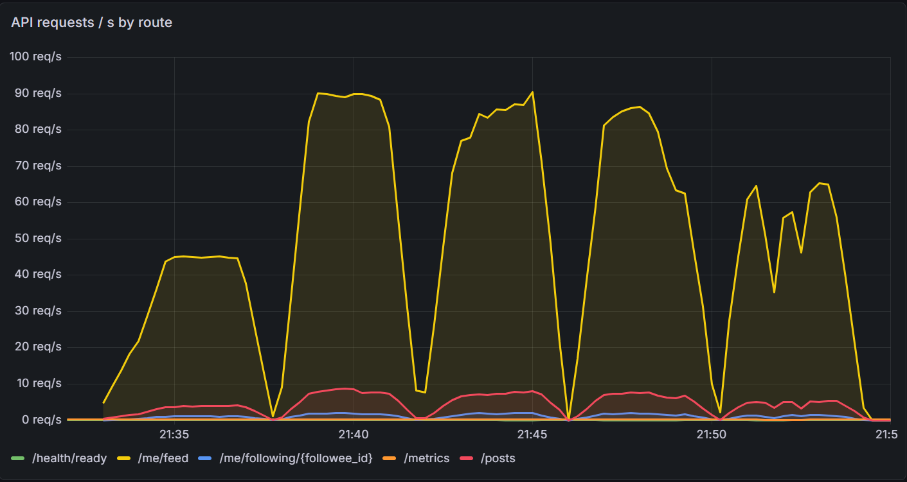
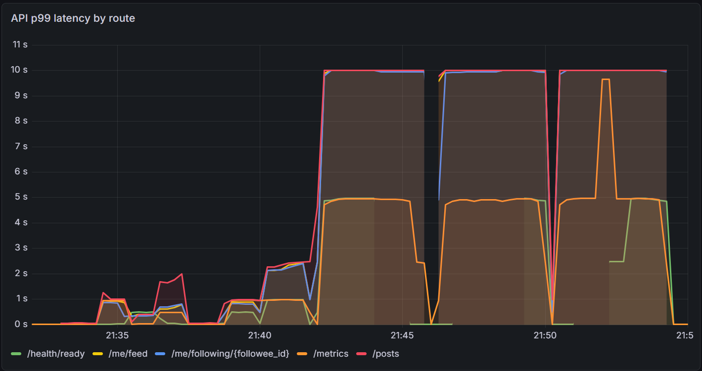
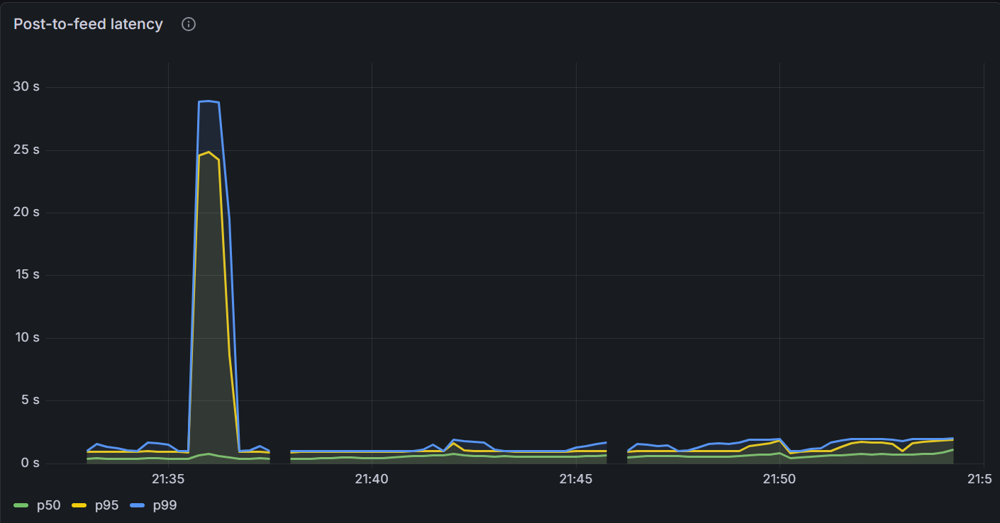
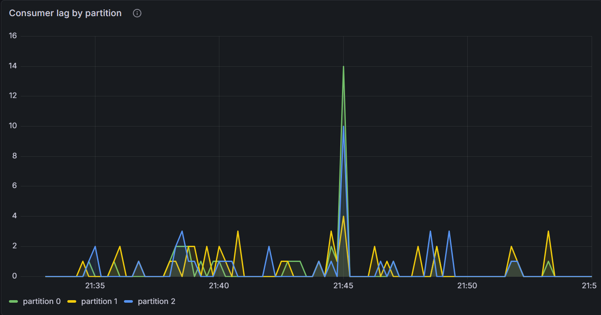

# Load test baseline, 2026-09-30

The first load test of feed-fanout: how much traffic it sustains on one known machine, what
gives out first, and how. It measures what exists, before any tuning. Every fix after this
is measured against these numbers, and appended to this log.

## Summary

- **Ceiling: about 95 requests/s**, set entirely by the API: one process on one CPU core, at
  **~7 ms of CPU per request**. Comfortable up to about 50/s: at 100/s nothing fails, but
  latency doubles.
- **Past the ceiling it collapses rather than slowing down.** Requests pile up, the API runs
  out of file descriptors (1,024 in the container), and can then neither accept connections
  nor reach its database. The more it's offered, the less it serves: 93/s at 200 offered,
  70/s at 800.
- **Everything behind the API had headroom:** Postgres used under half of one core (of the
  2 it's allowed), the fanout worker and the outbox relay about 3% of one.
- **Fanout-on-write held up, with one sharp exception.** 96% of posts were written into all
  their followers' feeds within 100 ms (99.5% within 250 ms), and typically reached feeds in
  about half a second.
  But one post by an account with ~20,000 followers took over 10 s to fan out, and with a
  single worker, every post behind it waited: the 26 s tail at 50/s.
- **Consumer lag missed that stall,** because the worker reports its own lag and was too busy
  to. Post-to-feed latency is what caught it.

## Setup

**Machine:** Intel i5-1245U laptop (15 W, 12 threads), Windows + WSL2 with 7.6 GB for Linux,
Docker. Plugged in, performance power mode. Commit `8d3180d`, run `20260930-213242`.

**Budget:** every service capped, so the result belongs to this budget
([`docker-compose.loadtest.yml`](../../../docker-compose.loadtest.yml)):

| Service | CPU | Memory |
|---|---|---|
| API (1 uvicorn process) | 1 core | 512 MB |
| Fanout worker (1) | 1 core | 256 MB |
| Outbox relay | 0.5 core | 256 MB |
| Postgres | 2 cores | 1.5 GB |
| Kafka (1 broker) | 1 core | 1 GB |
| k6 (load generator) | 1 core | 1 GB |

**Data** ([`seed.sql`](../../../loadtest/seed.sql)), loaded straight into Postgres:

| | |
|---|---|
| Users | 100,000 |
| Follows | 4,984,494 (each user follows 10–90 others, picked with a power-law bias) |
| Followers per user | median 35, p99 271, max 19,634 |
| Posts | 500,000 (5 per user) |
| Feed rows | 24,922,470: every post in every follower's feed, as fanout-on-write stores it |
| Database size | 4.7 GB, about 3x Postgres's memory limit, so reads hit the disk as they would at scale |

**Traffic** ([`feed.js`](../../../loadtest/feed.js), k6): from 10,000 active users, 90% feed
reads, 8% posts, 2% follows and unfollows. An **open model**: requests arrive at a fixed rate
whatever the response times, as real users do. A closed model (each virtual user waiting for
its response) quietly sends less when the system slows down, and hides exactly what this test
is looking for.

**Steps:** a 1-minute warm-up at 20/s, then 50, 100, 200, 400 and 800 requests/s for 3
minutes each, with a minute's pause after each. No SLO is applied: the post-to-feed delay is
measured, and the SLO is to be chosen from it.

## Results

| Offered | Sent by k6 | Served by the API | Failed | 5xx | Feed read p99 | Post → feed p50 / p99 | API CPU (of 1 core) |
|---|---|---|---|---|---|---|---|
| 50/s | 50/s | 50/s | 0% | 0 | 0.79 s | 0.43 s / 26.5 s | 36% |
| 100/s | 100/s | 100/s | 0% | 0 | 1.5 s | 0.46 s / 0.99 s | 73% |
| 200/s | 156/s | **93/s** | 54% | 4,190 | 14 s | 0.57 s / 1.3 s | 94% |
| 400/s | 370/s | **90/s** | 82% | 4,140 | 14 s | 0.57 s / 1.5 s | 98% |
| 800/s | 555/s | **70/s** | 89% | 2,284 | 16 s | 0.69 s / 1.9 s | 94% |

*Sent* falls short of *offered* when k6 runs out of virtual users because responses are too
slow. *Served* is what the API itself counted. The difference between the two is requests that
never got an answer: refused or cut off. The full report, with latency per endpoint and every
container's CPU and memory, is in [report.md](report.md); raw data in [data/](data/).



*Requests served per second, by route (feed reads are 90% of the traffic). They reach ~90/s,
then fall and stay ragged as the API collapses, whatever the offered rate.*



*p99 latency, by route. The flat line at 10 s is the histogram's top bucket, not the real
value: k6 measured 14–21 s. The `/metrics` line near 5 s is Prometheus's own scrapes of the
overloaded API, which is why the API's metrics have gaps while it's overloaded.*

## What we found

### 1. The API is the bottleneck, and it's CPU

At 50 and 100 requests/s the API used 36% and 73% of its core: **7.3 ms of CPU per request**,
the same at both rates. One core at 7.3 ms a request is ~135 requests/s in theory; in practice
it tops out at ~95, because an overloaded process also spends CPU on connections it can't
serve. Latency climbs well before that: at 100/s (73% busy) the p99 of every endpoint had
doubled, from queuing.

Nothing else was close: Postgres under half of one core (it's allowed 2), Kafka under half a
core, worker and relay about 3% of one. The database, the queue and the fanout are not what limits this system today.

7 ms is a lot for what these endpoints do (one indexed query for a feed read, three small
statements for a post). Where it goes is the next question, not yet answered.

### 2. Past the limit it collapses, instead of degrading

An API at its limit should still serve its ~95/s and turn the rest away quickly. This one
serves *less* the harder it's pushed (93, 90, 70/s), because of how it fails:

1. Requests arrive faster than they're answered, so connections accumulate: k6 opens up to
   1,000 at 200/s and 4,000 at 800/s, as clients would.
2. The API process can hold **1,024 open files**, the container's default, and every
   connection is one. At the limit, it can't open anything else.
3. It then can't accept new connections (**1,006** `OSError: Too many open files`), or even look
   up the database's address to open a connection to it (**7,586** "failed to resolve host
   'postgres': Too many open files"), and some existing database connections break (**1,768**
   "connection is bad"). Those become the 500s; the refused ones never reach the server.

Two missing defenses: nothing caps how many requests the API takes on at once (beyond it,
the right answer is a fast `503`), and the file limit was never set for a server's needs.

### 3. Fanout-on-write held up, except for one celebrity post

Across the run the worker fanned out 5,193 posts:

| Followers reached | Posts | | Fanout duration | Posts |
|---|---|---|---|---|
| up to 100 | 4,867 | | under 100 ms | 5,007 |
| 101–1,000 | 323 | | under 250 ms | 5,166 |
| 1,001–10,000 | 2 | | under 1 s | 5,192 |
| over 10,000 | **1** | | over 10 s | **1** |

The one post that reached over 10,000 followers is the one that took over 10 s: both were
recorded in the same scrape, 110 s into the 50/s step. Writing ~20,000 feed rows, with an
index that doesn't fit in memory, takes seconds. And there is **one worker, processing posts in
order**: for those 10+ s nothing else was fanned out, then the backlog cleared all at once.
Every post created meanwhile waited, which is the 26 s post-to-feed p99 at 50/s. At every other
step, posts reached feeds within 2 s at p99, even while the API was collapsing.

This is the known weakness of fanout-on-write: write cost grows with the author's audience,
and one big author delays everyone queued behind them. It's the case for a hybrid approach
(fan out ordinary authors on write; merge very large ones in at read time), and, separately,
for more than one worker.



*Post-to-feed latency: the celebrity stall is the ~29 s spike at 21:36. Everywhere else, p99
stays at 1–2 s, even during the API's collapse.*

### 4. The stall didn't show where we'd look for it



*Consumer lag, per partition. Almost nothing at 21:36, during the stall. The one spike (28
events, at the end of the 200/s step, 21:45) cleared within seconds; its cause wasn't
investigated.*

Consumer lag is the standard signal for "the workers are falling behind", and during the 10+ s
stall it barely moved. The reason: **the worker measures and reports its own lag**, and while
it's stuck writing one post, it can't update the metric either. The signal goes quiet at
exactly the moment it matters. Post-to-feed latency caught the stall; lag didn't. Lag should be
measured from outside the workers (from the broker's view of the consumer group), so a stuck
or dead worker still shows up as growing lag.

## What we got wrong along the way

- **The seed took about 50 minutes, not the ~15 estimated.** It inserted 25 million rows one by one
  into two indexes, under the memory limit set deliberately small for the test. Postgres read
  106 GB and wrote 170 GB to produce 4.7 GB. Bulk loads should build indexes once, after the
  data is in.
- **The seed blocked the relay.** It emptied the tables inside its one long transaction, while
  the app was running. The relay waited on that lock for the whole seed, its metrics requests
  timed out, and Docker still showed it healthy: the compose health check asks "started?", not
  "making progress?". Seeding should happen before the app starts.
- **The first report had two bugs.** The median post-to-feed column was always empty, and
  latencies past the top histogram bucket showed as "10000 ms" instead of "over 10 s". Both
  fixed, and the report regenerated from the same run's data in Prometheus.
- **The 5-second SLO was never chosen.** It was a placeholder that read like a decision. It's
  now marked provisional, to be set from these measurements.
- **The API's file limit was never considered** until it was the failure.

## Next: hypotheses to test

Each is a prediction, to be measured with the same test and appended here.

1. **Most of the 7 ms is per-request overhead, not the queries.** Profile the API under a
   modest load. Suspects: two HTTP middlewares, synchronous handlers and dependencies each
   hopping to a worker thread, ORM overhead, JSON logging of every request, token verification.
2. **A concurrency cap and a proper file limit turn the collapse into a plateau:** served stays
   near the ceiling at 800/s instead of falling to 70/s, and excess requests get fast `503`s
   instead of 500s and refused connections.
3. **A celebrity post shouldn't hold up everyone else.** More workers (Kafka has 3 partitions,
   so up to 3 help), then hybrid fanout for large accounts.
4. **Consumer lag measured outside the workers,** so a stalled worker shows up as lag.
5. **Then the SLO,** from the post-to-feed delay of the improved system.

## Reproduce

```bash
make down && make loadtest-setup && make loadtest   # then: make loadtest-down
```

See [loadtest/README.md](../../../loadtest/README.md).
